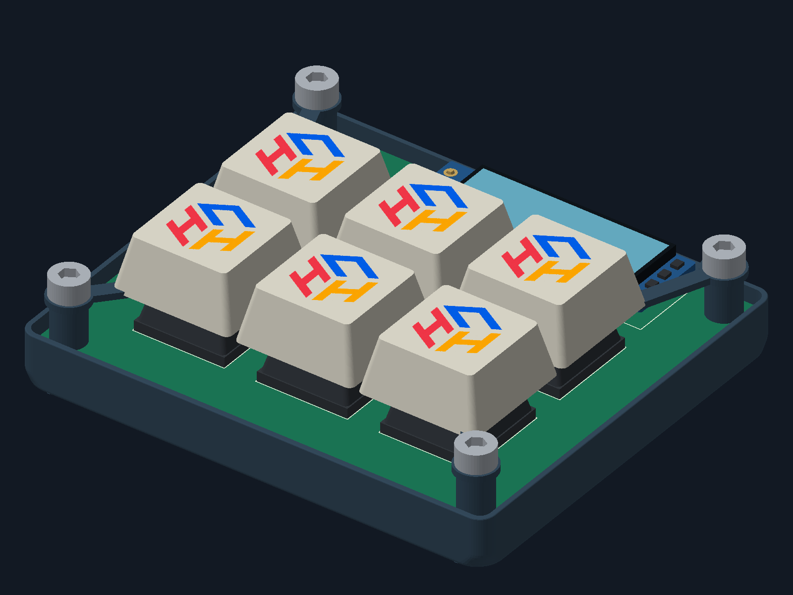

# IC Hack macropad

Six-key USB macropad with an OLED, addressable LEDs and a printable enclosure.

**Editing the appearance?** Start with the [artist handoff guide](appearance/README.md), or download the [self-contained handoff ZIP](build/appearance-handoff.zip). The [`appearance/`](appearance/) folder contains the colour config, PNG templates and image drop folder. No KiCad knowledge is needed.

The [reinforced frame](build/exports/top-frame-reinforced.stl) is the only frame version. It has **14.0 × 14.75 mm slots** (left/right × top/bottom), **6 mm straight standoffs with 0.8 mm walls**, a **flat 1 mm plate**, **2 mm links** and **2.4 mm mounting arms**. It uses the existing compact base, four **M3 × 12 mm socket-cap screws**, four M3 nuts and **no separate washers**. The flat top has no screw-head recesses; slimmer standoffs and smaller mounting pads reduce material use.

The updated [base](build/exports/base-m3x6.stl) has the USB opening's top lowered by **3 mm**, giving a **10.4 × 3.8 mm opening**. The bottom stays in place. See the [case guide](case/README.md) for connector fit and printing details.



[Exploded assembly](build/previews/top-frame-reinforced-exploded.png) · [Screw cross-section](build/previews/frame-cross-section.png) · [Printing and assembly](case/TOP-FRAME.md)

## Layout

| Folder | What belongs here |
| --- | --- |
| [`hardware/`](hardware/) | KiCad project, schematic, PCB and supplied STEP reference |
| [`case/`](case/README.md) | Enclosure CAD and presets |
| [`appearance/`](appearance/README.md) | Teammate handoff: hex colours, image drop folder and PNG guides |
| [`accessories/`](accessories/README.md) | Printable washers and M3 nut-fit tester |
| [`firmware/`](firmware/README.md) | Custom on-device software, board pin map and bring-up notes |
| `tools/` | Shared Python build, rendering and verification scripts |
| `build/` | Generated meshes, renders, reports, CAD inputs and supplier artwork |

The original ZIP is kept in `hardware/original/`. Edit the unpacked KiCad project in `hardware/`.

## Development commands

Run commands from this folder. The existing system Python packages work on this machine. For a separate environment elsewhere:

```bash
python3 -m venv .venv
. .venv/bin/activate
python -m pip install -r requirements.txt
```

The CAD workflow needs Python 3.10+, OpenSCAD, GNU Make 4.3+, and the DejaVu Sans font used by the renderer. Python requirements are listed in [`requirements.txt`](requirements.txt); firmware tools are separate.

```bash
make prepare   # Generate CAD inputs before opening OpenSCAD
make build     # Export printable parts and run exact clearance checks
make preview   # Build as needed, then refresh renders and supplier artwork
make check     # Refresh previews, then run the full design checks
make board     # Render front/back PCB images
make templates # Regenerate the artist’s PNG guides and blank canvases
make top-frame # Build and preview the reinforced switch retaining top
make all       # Full checks plus board images
```

`make` lists the commands. Set `PYTHON=/path/to/python` to use another interpreter. The Makefile handles the order; PCB edits automatically refresh extracted geometry, and colour/artwork edits reuse existing meshes. Deleting a required mesh triggers a rebuild. Use `make clean` to remove all generated output, then `make all` to reproduce it.

## What to edit

- **PCB/electronics:** open `hardware/IC Hack Macro Pad.kicad_pro`. Run `make preview` afterwards and update the firmware pin map if wiring changed. The supplied STEP file is a reference export, not automatically regenerated.
- **Enclosure dimensions:** edit `case/macropad_case.scad`, then run `make check`. Existing dimensional checks encode the current design; deliberate dimension changes may require updating their expected measurements.
- **OpenSCAD preview:** run `make prepare`, then open `case/macropad_case.scad` and select a preset. `base-m3x6.scad` opens the existing compact printable base. The reinforced frame uses M3 × 12 mm screws.
- **Accessories:** open an entry point in `accessories/`. Accessory modules share the enclosure's fastener dimensions so fit stays consistent.
- **Colours, keycap images and PCB artwork:** edit `appearance/config.json` and images in `appearance/images/`, then run `make preview`. See [appearance notes](case/APPEARANCE.md).
- **Custom software:** start in [`firmware/`](firmware/README.md); the pin map is taken from this PCB.

## Outputs

| Path | Contents |
| --- | --- |
| `build/exports/base-m3x6.stl` | Existing compact base for the reinforced frame |
| `build/exports/top-frame-reinforced.stl` | [Reinforced retaining top; no separate washers](case/TOP-FRAME.md) |
| `build/exports/accessories/` | Printable washers and nut-fit tester |
| `build/exports/keycap.stl` | Printable keycap copied from the clicker project |
| `build/previews/` | Current frame assemblies, exploded view, cross-section and reference meshes |
| `build/exports/*-checks.json` | Verification reports |
| `build/exports/logs/` | OpenSCAD export and clearance logs |
| `build/print-pack/` | Keycap artwork, manifest and supplier CSV |
| `build/appearance-handoff.zip` | Self-contained artist handoff, also available as the `appearance/` folder |
| `build/board/` | Front/back PCB PNG and SVG |
| `build/generated/` | Extracted board datums, silkscreen and generated CAD colours |

Everything under `build/` can be regenerated. Current printable exports, previews, check reports, PCB images and the artwork pack are checked in so they can be viewed and downloaded directly. Intermediate CAD inputs, reference meshes, caches and logs are ignored. Keep source changes outside `build/`. See the [case guide](case/README.md) for printing and assembly details.
