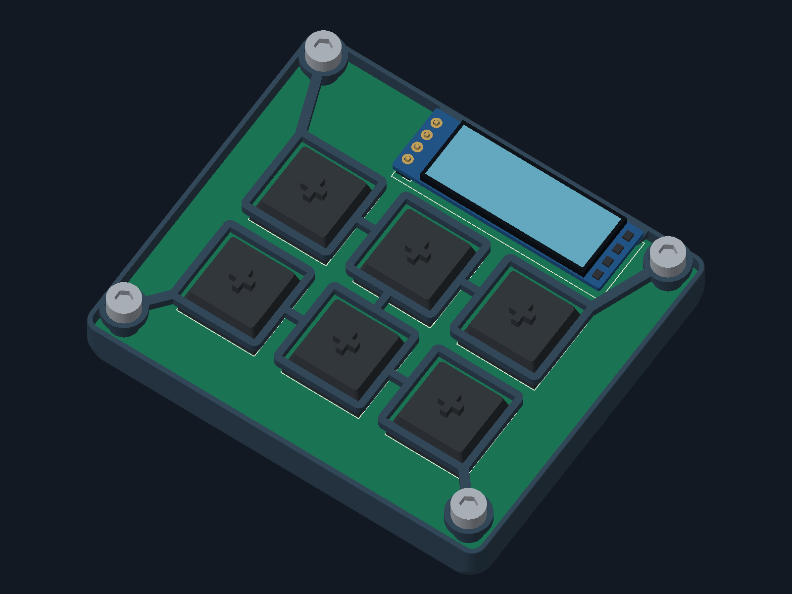
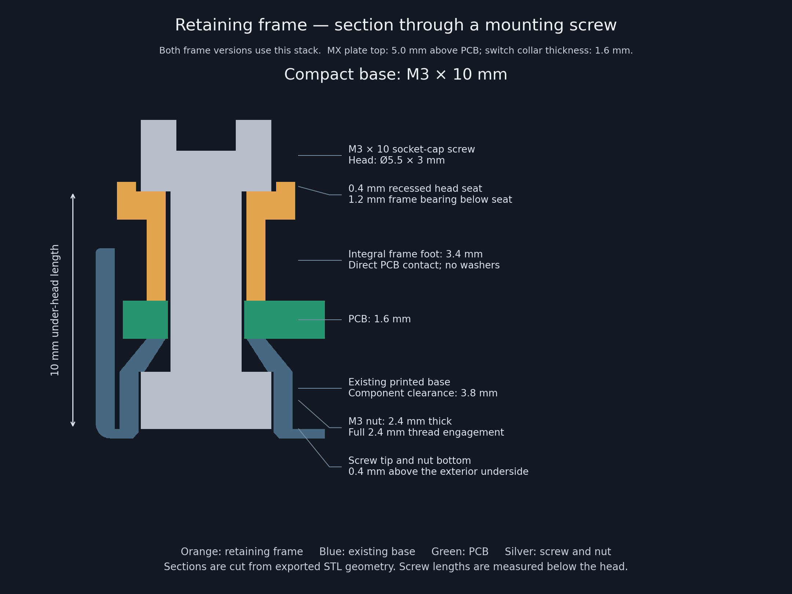
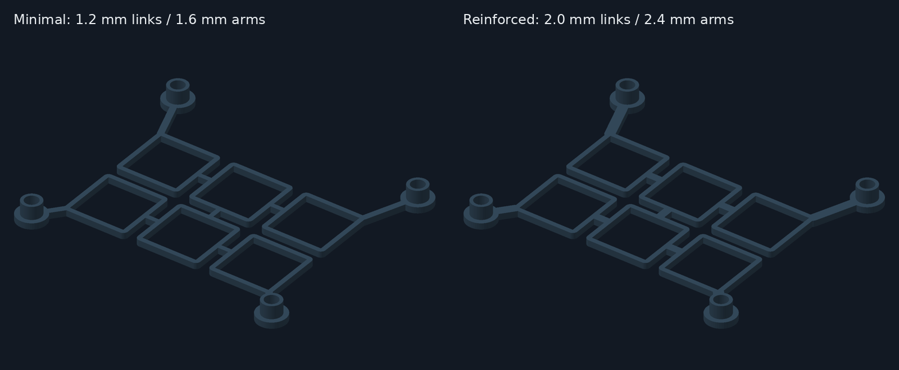

# Minimal switch retaining top

Six small MX collars, five short links and four corner arms attach to the **existing four PCB screws**. There is no surrounding top panel and nothing across the OLED area. The keycaps go **over** the frame, on their normal stems. This retains the **switches**, using their plate clips; keycaps remain removable.

[With keycaps fitted](../build/previews/top-frame-assembly.png) · [Exploded view](../build/previews/top-frame-exploded.png) · [Top view](../build/previews/top-frame-top.png) · [Print orientation](../build/previews/top-frame-print.png)

The interface assumes standard full-height **MX-compatible blue switches**: 14 × 14 mm square openings, a 1.6 mm plate (the upper end of the usual 1.5 ± 0.1 mm clip land), and a plate upper face 5 mm above the PCB. The collars are only **1.2 mm wide**; the joining links are 1.2 mm wide and the four screw arms are 1.6 mm wide. The plate fits beneath the switch flanges: the spring clips latch below it and resist extraction. It does not trap switches by pressing down on their top housings.

Two versions are available:

| Version | Links between switches | Arms to screw mounts | Printable file |
| --- | --- | --- | --- |
| Original minimal | 1.2 mm | 1.6 mm | [top-frame.stl](../build/exports/top-frame.stl) |
| Reinforced | 2.0 mm | 2.4 mm | [top-frame-reinforced.stl](../build/exports/top-frame-reinforced.stl) |

The reinforced version adds width to the five links and four mounting arms. The switch collars, clip thickness, screw positions and integral feet are identical, so the keycap interface and hardware stay the same. It is the recommended version where durability matters; strength still depends on material and print quality. [Reinforced assembly](../build/previews/top-frame-reinforced-assembly.png) · [Reinforced exploded view](../build/previews/top-frame-reinforced-exploded.png) · [Reinforced frame with keycaps removed](../build/previews/top-frame-reinforced-without-keycaps.png). Open [top-frame-reinforced.scad](top-frame-reinforced.scad), choose a reinforced preset, or set `frame_reinforced=true` in an assembly.

The existing PCB datums supply all six switch centres and the **63 × 53 mm screw spacing**. Integral **3.4 mm insulating feet touch the PCB directly** at its mounting holes, replacing the lower washers. The screw heads bear directly on the frame too: **there are no separate washers above or below it**. A 0.4 mm head recess leaves 1.2 mm of frame bearing material above each foot. Each head pocket is 5.9 mm diameter, within a 7.5 mm mounting pad with 0.8 mm radial walls. No feet touch the exposed PCB between mounts. The selected setup is the compact base with M3 × 10 mm screws; the tall-base version has been retired.

| Existing base | Screws with frame (under-head length) |
| --- | --- |
| `base-m3x6.stl` (existing compact base) | Four **M3 × 10 mm** |

Keep the existing four M3 nuts. **Remove all old washers.** The frame and its recessed bearing seats allow standard screws 4 mm longer than the original base specification, keeping the original **0.4 mm tip recess and full 2.4 mm nut engagement**. The existing compact base does not need reprinting. Its filename retains the original base-only 6 mm screw datum; the actual screw length with the frame is 10 mm. In CAD, `screw_length` still identifies the original **base**, and `with_top_frame=true` adds 4 mm to its actual screw length.

Print:

- One [minimal](../build/exports/top-frame.stl) or [reinforced](../build/exports/top-frame-reinforced.stl) top frame, already oriented with the flat plate face on Z=0 and the four feet upwards.

Use 0.4 mm extrusion width, 0.2 mm layers, three perimeters and solid fill. No supports are needed; the four recessed head seats require short **5.9 mm bridges** with the plate face on the bed. Keep the aperture edges square and remove first-layer flare; a large elephant-foot lip can obstruct the clips. PETG is suitable for the thin links. Avoid scaling the whole STL to change aperture fit because it would also move the screw and switch centres.

1. Remove the keycaps and switches, then remove the four original screws. Keep the PCB seated on its base.
2. Remove the old washers. Lower the frame with its four insulating feet resting directly on the PCB around the mounting holes.
3. Loosely install four M3 × 10 mm screws. The heads sit directly in the frame's shallow recesses.
4. Insert each switch through its collar into the hot-swap socket. Support the PCB/socket underneath while seating switches; the frame is not a brace for insertion force. Both switch clips must latch beneath the collar and the flange must sit on top.
5. Tighten the four screws gently and evenly, then refit the keycaps over the frame. Check that every key bottoms out and returns freely, and that a gentle pull leaves each switch latched.

Clone switch clips and keycap undersides vary. **Confirm clip engagement and full key travel on the physical print before relying on retention.** The existing electronics meshes are simplified references, not manufacturer geometry. The CAD checks verify frame/base/electronics/hardware separation, closed connected geometry, the six actual aperture walls, plate thickness, and screw-tip positions. They do not verify clip spring action, printed strength, or the internal clearance of the user's keycaps.

Regenerate from the project root with `make top-frame`. `make build`, `make preview` and `make check` also include the frame. Sources: [top-frame.scad](top-frame.scad), [top-frame-reinforced.scad](top-frame-reinforced.scad), [top-frame-assembly.scad](top-frame-assembly.scad), and [top_frame_modules.scad](top_frame_modules.scad). OpenSCAD presets cover printing and both assemblies. Current renders show only the frame setup; superseded open-top and washer views have been removed. The cross-section is sliced from the actual exported meshes by [frame_section.py](../tools/frame_section.py). Reports are in `build/exports/top-frame-checks.json` and `build/exports/frame-section-dimensions.json`.

Exploded views separate the nuts, base, PCB with OLED/USB, frame, switches, keycaps and M3 × 10 mm screws. There are no washer parts. Both frame variants have matching OpenSCAD exploded presets.
