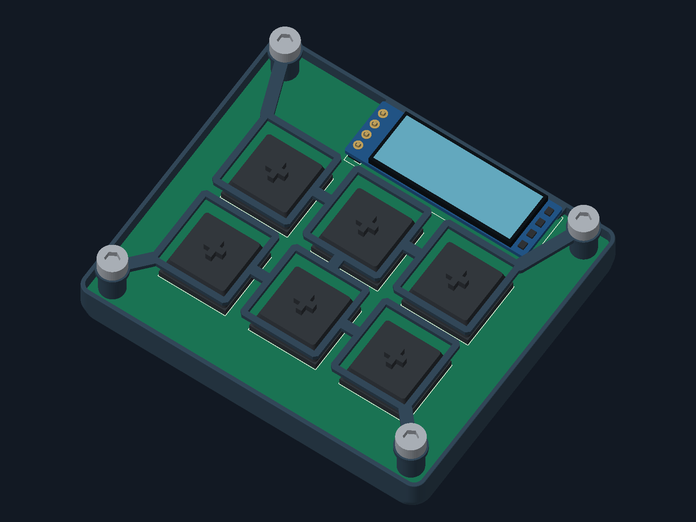

# Reinforced switch retaining top

The [reinforced frame](../build/exports/top-frame-reinforced.stl) is the only frame version. It combines the wider links and mounting arms with the latest prototype fit: **14.0 × 14.75 mm switch openings, 6 mm standoffs and a flat 1 mm horizontal plate**. It attaches to the existing four PCB mounts, leaving the OLED area open. Keycaps fit over the frame on their usual stems.

[Assembly](../build/previews/top-frame-reinforced-assembly.png) · [Exploded view](../build/previews/top-frame-reinforced-exploded.png) · [Top view](../build/previews/top-frame-reinforced-top.png) · [Print orientation](../build/previews/top-frame-reinforced-print.png)

| Feature | Dimension |
| --- | --- |
| Switch slots | **14.0 mm left/right × 14.75 mm top/bottom** |
| Collars around switches | 1.2 mm wide |
| Links between switches | **2.0 mm wide** |
| Arms to screw mounts | **2.4 mm wide** |
| Horizontal plate | **1.0 mm thick**, five 0.2 mm layers |
| Integral standoffs | **6 mm tall**; Ø5 mm outside, Ø3.4 mm through bore |
| Standoff walls | **0.8 mm radial thickness throughout**; straight cylinders with no taper or widened roots |
| Overall frame height | **7 mm** |
| Existing mounting-hole spacing | 63 × 53 mm |
| Head seat | Flat upper face; no recesses |
| Screw-mount pads | 6.2 mm diameter, supporting Ø5.5 mm heads |
| Screws | **Four M3 × 12 mm socket-cap screws**, measured under the head |

Standoff height is measured from the PCB top to the underside of the horizontal plate. The existing compact [base-m3x6.stl](../build/exports/base-m3x6.stl) and four M3 nuts are reused. The historical base filename and CAD `screw_length=6` describe the original base-only datum; the installed frame requires **12 mm screws**.

**No separate washers are needed.** Insulating feet touch the PCB directly. Screw heads bear on the 6.2 mm pads in the flat 1 mm plate, above the straight Ø5 mm standoffs. The head's outer edge extends 0.25 mm radially beyond the standoff; the plate carries that small span. M3 × 12 mm screws provide **2.0 mm nut engagement**, with their tips **0.8 mm above the exterior underside**. Earlier base prints still fit the frame; reprint the updated base to get the USB opening with its top lowered by 3 mm.

## Printing and assembly

Print [top-frame-reinforced.stl](../build/exports/top-frame-reinforced.stl), already oriented with the flat plate face on Z=0 and the four feet pointing up. The design uses a **0.4 mm nozzle and 0.2 mm layers**, matching the Bambu P1S setup in Bambu Studio. Use the appropriate material profile, three wall loops and solid fill; the slicer fits fewer paths in the 0.8 mm standoff walls as needed. No supports are needed: the plate sits directly on the bed and the straight standoffs rise from it, without recessed ceilings to bridge. Remove first-layer flare from the switch openings. Do not scale the whole STL to change slot fit, because that also moves the switch and screw centres.

The lighter frame keeps the 1.2 mm collars, 2 mm links, 2.4 mm arms and 1 mm plate. Material is removed from the standoffs and excess mounting-pad diameter. Each standoff has a constant 0.8 mm radial wall for its full 6 mm height, with no taper or thickened root. Chamfered outer collar corners replace small curved paths. There are no extra pockets or isolated pieces to add perimeter and travel moves. Slicer filament use and print time still depend on the material profile, line widths and cooling settings; the mesh report measures geometric material volume, not a sliced time estimate.

The exported mesh volume is **873.58 mm³**, recorded in `build/exports/top-frame-checks.json`: **7.8% less** than the tapered-foot revision (947.32 mm³), and **21.0% less** than the earlier 15 × 15 mm slot frame with Ø6 mm feet and recessed screw heads (1105.39 mm³). Actual print time has not been measured in Bambu Studio.

1. Remove the keycaps, switches and screws from the existing assembly. Keep the existing nuts and remove any washers.
2. Lower the frame with its four insulating feet resting directly on the PCB mounting areas.
3. Loosely install four **M3 × 12 mm** screws against the flat mounting pads.
4. Insert switches through the collars into the hot-swap sockets, supporting the PCB/socket underneath while seating them. Check housing/clip contact at the new height on the actual clone switches.
5. Tighten gently and evenly, refit the keycaps and check full travel and return. A gentle pull should leave the switches retained.

This is a prototype fit based on the user's printed-part corrections. **Check switch retention and key travel on the physical print.** Switch and keycap render meshes are simplified references. CAD checks cover the actual aperture walls, plate thickness, reinforced link/arm widths, standoffs, screw positions, closed connected geometry and frame/base/electronics/hardware clearance; they do not prove clip spring action or physical strength.

## Sources and regeneration

Run `make top-frame` for the printable frame and current assembly, exploded and section views; `make check` also runs the design checks. The only printable-frame entry point is [top-frame-reinforced.scad](top-frame-reinforced.scad); [top-frame-assembly.scad](top-frame-assembly.scad) opens the assembly. Shared dimensions are in [top_frame_modules.scad](top_frame_modules.scad). OpenSCAD presets cover the reinforced assembly, exploded view, frame print and base print.

[frame_section.py](../tools/frame_section.py) slices the actual meshes for the cross-section. Reports are in `build/exports/top-frame-checks.json` and `build/exports/frame-section-dimensions.json`.
